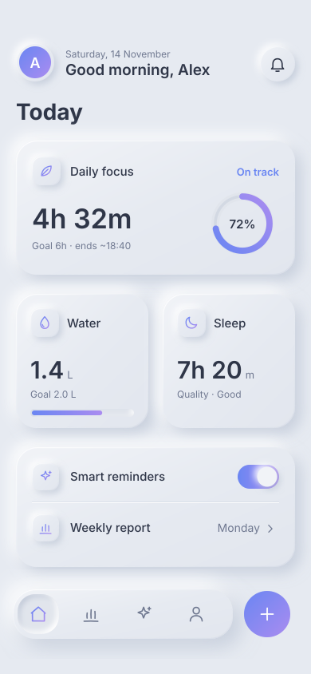
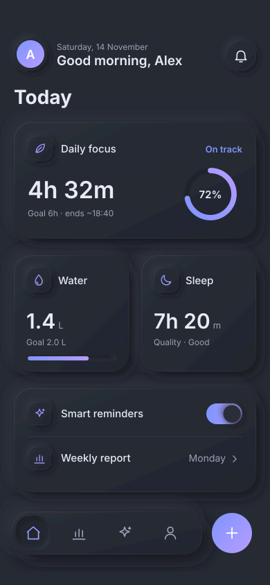
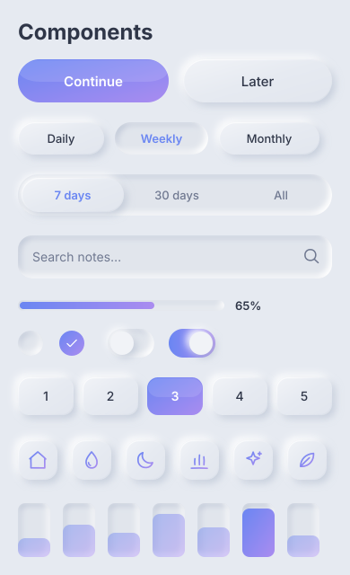
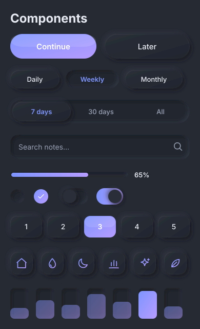

# haniya-relief-ui

A general-purpose **soft relief** design language, packaged as a Claude Code skill so every app built with it shares one look: realistic neumorphism, a sparing two-stop gradient glaze, hand-drawn pen icons, calm CJK-friendly typography, five palettes (four light, one dark) and runtime multi-language UI.

| Light | Dark |
|---|---|
|  |  |
|  |  |

*Illustrative mockups generated from the tokens; content is placeholder.*

## Contents
- `SKILL.md` — entry point: the ten rules and how to apply them
- `references/` — principles, tokens, material recipes (Compose / CSS / SwiftUI / Flutter), components and layout patterns, hand-drawn icon algorithm, i18n, review checklist
- `compose/` — reference Jetpack Compose implementation in package `com.example.relief` (theme, materials, components, icon engine, i18n)
- `examples/` — generic SVG mockups (light and dark)

## Install as a skill
```bash
git clone https://github.com/TodayYueC/haniya-relief-ui ~/.claude/skills/haniya-relief-ui
```
Then ask Claude Code, e.g. "build this screen in the haniya-relief-ui style".

## Using the Compose code
1. Copy `compose/` into your design-system module and rename the package `com.example.relief`.
2. Requirements: Compose BOM 2026.09+ (uses `Modifier.dropShadow` / `innerShadow`), Material3, `androidx.core` (`PathParser`), `activity-compose` (sheet back handling), Coil 3 (avatar photos).
3. Put the Inter variable font at `res/font/inter_variable.ttf` (used by `Type.kt`).
4. Wrap your UI in `ReliefTheme(ReliefPalette.PLATINUM)` and use `ReliefTheme.colors` / `ReliefTheme.type`.
5. Optional i18n: provide `assets/i18n/source.txt` and one line-aligned file per language; call `I18n.init(context)` at startup and provide `LocalLanguage`.

The code compiles as a standalone Android library module with only the dependencies above.

## License
Code and documentation: use freely in your own projects. Inter is licensed under the SIL Open Font License.
